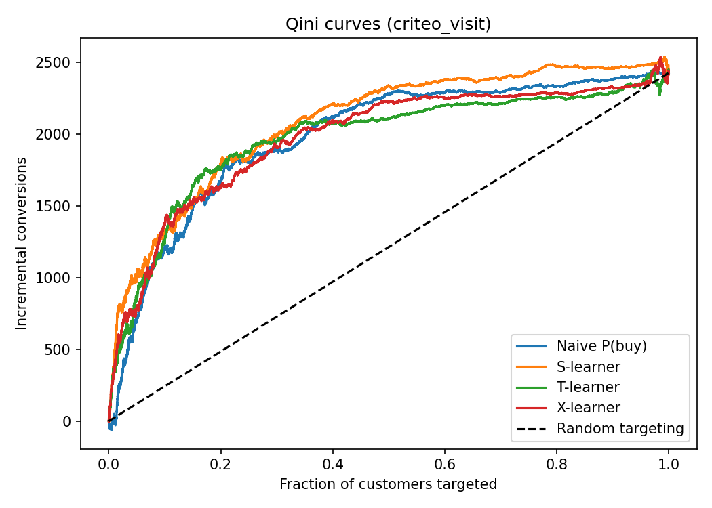
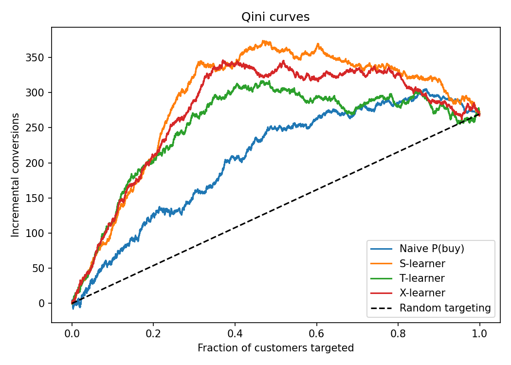

# Uplift Modeling for Marketing Targeting

By Nitesh | [GitHub](https://github.com/NiTeSH9860/uplift-targeting)

Most marketing models predict **who will buy**. This project asks a more useful question: **who will respond *because* we contacted them?** I estimate individual treatment effects from randomized experiment data, evaluate the models with Qini curves and paired bootstrap tests, turn the scores into a profit-optimized targeting policy, and serve it through a FastAPI service with a Streamlit dashboard.

## Key findings

All results are from a 1M-row random sample of Criteo Uplift v2.1 unless stated otherwise. Intervals are 95% bootstrap intervals on a held-out test set.

- **Targeting beats blanket contact.** Assuming a value of 1.0 per visit and a contact cost of 0.01, targeting by S-learner uplift earns about 5.9 per 1,000 customers (95% CI 4.2 to 7.7) versus 1.0 for contacting everyone. The paired difference is +5.0 per 1,000 (CI 4.0 to 6.1), and it grows as the contact cost rises.
- **The S-learner ranks customers better than a P(visit) baseline.** Paired AUUC gain is +91 (CI 8 to 196). The top decile shows a 5.0pp visit lift against a 1.1pp average.
- **That ranking edge does not turn into a measurable profit edge.** The paired profit difference between the S-learner and the P(visit) baseline includes zero at every cost I tested except the lowest, where the baseline is slightly better.
- **On the rare outcome (conversion, 0.3%), uplift models did not beat the baseline.** This held at 1M and 4M rows and with two sets of model settings. The X-learner was significantly worse with default settings.
- **On Criteo, P(outcome) is a strong baseline**, because customers who already visit often also show the largest absolute lift.

## What's in the repo

```
experiments (run.py, run_policy.py, run_sensitivity.py)
        -> trained model (train_final.py -> models/)
        -> API (app/api.py)
        -> dashboard (app/dashboard.py)
```

## Quick start

The trained model is included in the repo, so the API and dashboard run without downloading the dataset.

```bash
git clone https://github.com/NiTeSH9860/uplift-targeting.git
cd uplift-targeting
python3 -m venv .venv && source .venv/bin/activate
pip install -r requirements.txt
```

Start the API (Terminal 1):

```bash
uvicorn app.api:app
```

Start the dashboard (Terminal 2):

```bash
streamlit run app/dashboard.py
```

Interactive API docs are at `http://127.0.0.1:8000/docs`. Run the tests with `python3 -m pytest` (17 tests).

**With Docker:**

```bash
docker build -t uplift-api .
docker run --rm -p 8000:8000 uplift-api
```

The image uses Python 3.9 and the exact library versions in `requirements-api.txt`, which are the versions the model was trained with. Predictions from the container match local predictions (checked on five customers).

## API

| Endpoint | Purpose |
|---|---|
| `GET /health` | Is the service up |
| `GET /model-info` | Model target, training size, training date, features, score median and 90th percentile |
| `POST /score` | Predicted uplift and rank for each customer (up to 1,000 per request) |
| `POST /recommend` | Contact / don't contact for each customer, given a value per visit, a contact cost, and an optional cap on contacts |

`/recommend` contacts a customer only if `value x predicted uplift - cost` is positive. With a cap, it keeps the customers with the highest expected profit.

`top_percent` is the customer's rank among held-out customers: **lower is better**, and a value above 50 means the customer ranks below the median. Example response from `/score` (five real Criteo customers):

```json
{"results": [
  {"uplift": 0.04923, "top_percent": 4.7},
  {"uplift": 0.00006, "top_percent": 87.5},
  {"uplift": 0.00447, "top_percent": 21.0},
  {"uplift": 0.00274, "top_percent": 24.9},
  {"uplift": 0.00622, "top_percent": 18.7}
]}
```

Invalid input (missing features, non-numeric values, negative cost, empty or oversized batches) is rejected with a 422 and covered by tests.

## Dashboard

The Streamlit dashboard calls the API. Choose a value per visit, a contact cost, and an optional budget cap; it shows how many customers to contact, expected profit for targeting versus contacting everyone, a profit curve, and a downloadable contact list. It runs on a 500-customer demo sample, or on an uploaded CSV with columns `f0` to `f11`.

## Problem

A company has a limited budget. Customers fall into four groups: *persuadables* (act only if contacted), *sure things*, *lost causes*, and *sleeping dogs* (contact reduces their chance of acting). A standard classifier cannot tell these apart. Uplift modeling estimates the effect of contacting each customer, so budget goes where it changes behavior.

## Data

- **Criteo Uplift v2.1**: about 14M rows, 12 features, randomized treatment (about 85% treated), outcomes `visit` (about 4.7%) and `conversion` (about 0.3%). Source: Criteo AI Lab; Diemert et al., *A Large Scale Benchmark for Uplift Modeling*, AdKDD 2018. Licensed CC BY-NC-SA 4.0 (non-commercial).
- **Synthetic data** with a known true effect (persuadables +8pp, sleeping dogs -4pp), used to test that the metrics and models recover the truth.
- The `exposure` column is deliberately excluded. It is measured after treatment and would leak the outcome.

## Methods

- **Models** (LightGBM base learners): naive P(outcome) classifier (not an uplift model), S-learner, T-learner, X-learner. A second parameter set (shallow trees, large leaves) is used for the rare conversion outcome.
- **Checks:** covariate balance (standardized mean differences, all under 0.05 on Criteo) and the average treatment effect.
- **Evaluation:** Qini curves, AUUC, uplift@k, decile tables, and **paired bootstrap** comparisons (both models scored on the same resampled customers).
- **Decision layer:** profit = value x incremental outcomes - cost x contacts. The contact cutoff is chosen on a validation set and profit is reported on a separate test set.
- **Served model:** the S-learner trained on Criteo `visit`, the one setting where uplift ranking clearly beat the baseline.

## Results

**Ranking quality, Criteo `visit`** (paired AUUC difference vs the naive baseline):

| Model | Difference | 95% CI |
|---|---|---|
| S-learner | +90.9 | 8.2 to 196.1 |
| T-learner | -28.2 | -278.1 to 226.0 |
| X-learner | -25.2 | -276.2 to 206.1 |

**Ranking quality, Criteo `conversion`:**

| Model | 1M rows, default | 4M rows, default | 1M rows, sparse settings |
|---|---|---|---|
| S-learner | -11.6 (-54.0 to 30.9) | -26.0 (-69.0 to 20.5) | +3.7 (-12.5 to 22.6) |
| T-learner | -39.1 (-90.7 to 21.0) | -96.5 (-207.7 to 21.4) | -90.6 (-133.0 to -54.1) |
| X-learner | -79.9 (-143.7 to -11.8) | -152.0 (-235.1 to -52.7) | -13.2 (-35.5 to 11.7) |

**Profit per 1,000 customers, Criteo `visit`** (value 1.0 per visit; S-learner minus contacting everyone):

| Contact cost | Difference | 95% CI |
|---|---|---|
| 0.005 | +1.7 | 0.7 to 2.5 |
| 0.010 | +5.0 | 4.0 to 6.1 |
| 0.020 | +12.6 | 11.1 to 14.2 |
| 0.030 | +21.7 | 20.2 to 23.3 |

**Synthetic data** (value 10, cost 0.5): contacting everyone loses 312 per 1,000 customers, while the S-learner earns +42 (CI 12 to 65) by contacting about 26% of customers. The naive P(buy) model earns about +1 because it ranks by who buys anyway.




## Assumptions

Value per visit (1.0) and contact cost (0.002 to 0.03) are **assumptions I chose**, not facts about Criteo. A visit is not revenue. Conclusions about profit depend on these numbers, which is why the cost is varied rather than fixed.

## Limitations

- One 1M-row sample (4M for one conversion run), one train/validation/test split, and 100 to 200 bootstrap rounds. The paired bootstrap resamples the test set only and does not capture variation from retraining or from choosing the cutoff.
- The conversion experiments were scored on the same test set after seeing the first results, so the sparse-settings run is exploratory.
- Outcomes are short-term (visits, conversions). Long-term effects, unsubscribes, and contact fatigue are not measured.
- The S-learner shrinks effects toward zero. On a 500-customer demo sample the dashboard's "contact everyone" estimate (about -2.6 per 1,000) was lower than the measured +1.0 per 1,000, so dollar figures are model estimates and the ranking is more reliable than any single number.
- Results on Criteo may not transfer to settings where baseline propensity and treatment effect are unrelated.
- The demo sample is not an evaluation set: the model was trained on a different 1M-row sample, and some demo customers may overlap with it.

## Path to production

This is a prototype of the full workflow, not something to point at a real customer base as-is. A real deployment would need:

- **Retraining on the company's own randomized experiment.** The served model uses Criteo's anonymized features, which mean nothing for other customers.
- **A holdout group and an online A/B test of the targeting policy itself**, compared against the current approach. That is the real test of whether targeting pays off.
- **Measured economics:** value and cost from actual margin and campaign spend, not assumed numbers.
- **Monitoring and retraining** as customer behavior drifts.
- **Authentication and privacy controls** on the API. It currently has none, and real customer data brings consent requirements.
- **Propensity adjustment** if treatment was not randomized. Everything here assumes a randomized experiment; observational data is not handled.
- **Fairness checks** across customer groups, and request logging.

## Security note

The model file is a pickle, which can run code when loaded. Only load model files you trained yourself.

## Reproduce the experiments

The experiments need the Criteo file (about 300MB compressed):

```bash
mkdir -p data
curl -L -o data/criteo-uplift-v2.1.csv.gz "https://huggingface.co/datasets/criteo/criteo-uplift/resolve/main/criteo-research-uplift-v2.1.csv.gz"

python3 run.py                                                   # synthetic data
python3 run.py --criteo 1000000 --target visit
python3 run.py --criteo 1000000 --target conversion --params sparse
python3 run_policy.py --criteo 1000000 --target visit
python3 run_sensitivity.py --criteo 1000000 --target visit
python3 train_final.py                                           # retrain the served model
```

## Structure

```
src/data.py          data loading and synthetic generator
src/checks.py        randomization check, ATE
src/evaluation.py    Qini, AUUC, uplift@k, deciles, bootstrap, paired bootstrap
src/models/          naive baseline, S/T/X-learners
src/policy.py        profit curve and cutoff selection
run.py               model comparison
run_policy.py        profit evaluation with validation-chosen cutoff
run_sensitivity.py   profit across contact costs
train_final.py       trains and saves the served model
app/api.py           FastAPI service
app/dashboard.py     Streamlit dashboard
models/              trained model (688KB)
Dockerfile           container for the API
tests/               evaluation tests and API tests
```
