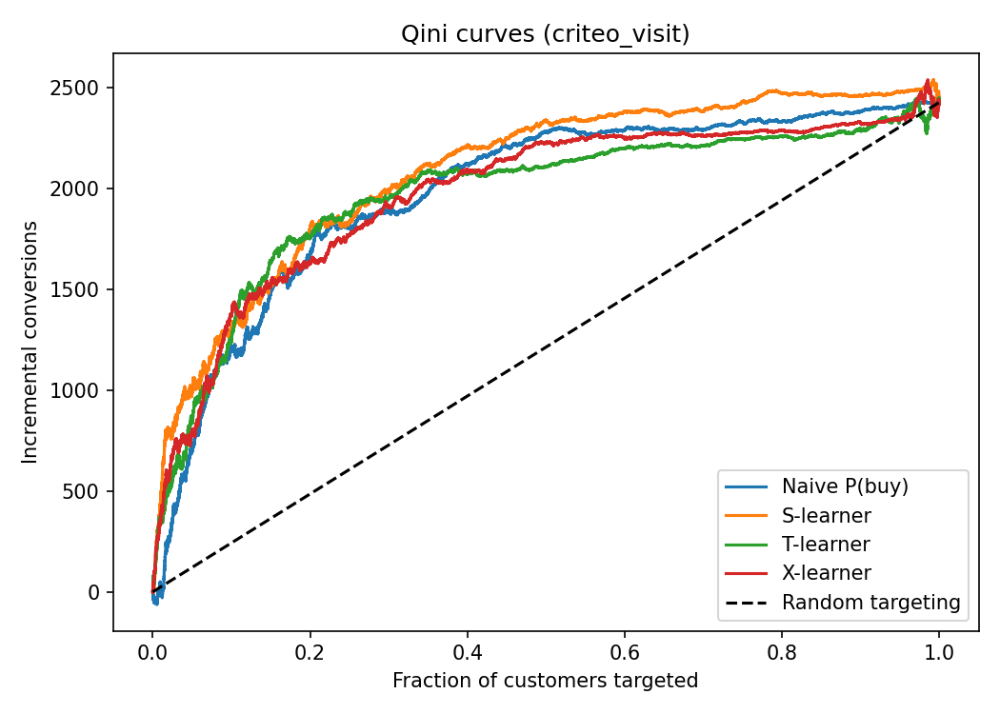
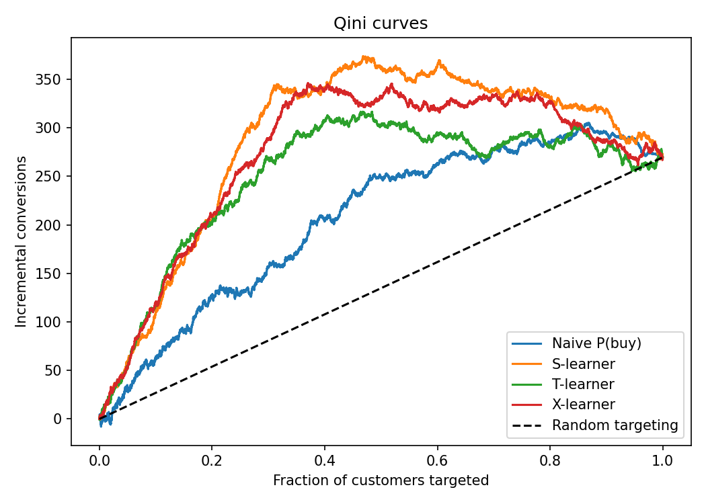

# Uplift Modeling for Marketing Targeting
By Nitesh | [GitHub](https://github.com/NiTeSH9860/uplift-targeting.git)
Most marketing models predict **who will buy**. This project asks a more useful question: **who will respond *because* we contacted them?** I estimate individual treatment effects from randomized experiment data, evaluate the models with Qini curves and paired bootstrap tests, and convert the scores into a profit-optimized targeting policy.

## Key findings

All results are from a 1M-row random sample of Criteo Uplift v2.1 unless stated otherwise. Intervals are 95% bootstrap intervals on a held-out test set.

- **Targeting beats blanket contact.** Assuming a value of 1.0 per visit and a contact cost of 0.01, targeting by S-learner uplift earns about 5.9 per 1,000 customers (95% CI 4.2 to 7.7) versus 1.0 for contacting everyone. The paired difference is +5.0 per 1,000 (CI 4.0 to 6.1), and it grows as the contact cost rises.
- **The S-learner ranks customers better than a P(visit) baseline.** Paired AUUC gain is +91 (CI 8 to 196). The top decile shows a 5.0pp visit lift against a 1.1pp average.
- **But that ranking edge does not turn into a measurable profit edge.** The paired profit difference between the S-learner and the P(visit) baseline includes zero at every cost I tested except the lowest, where the baseline is slightly better.
- **On the rare outcome (conversion, 0.3%), uplift models did not beat the baseline.** This held at 1M and 4M rows and with two sets of model settings. The X-learner was significantly worse with default settings.
- **On Criteo, P(outcome) is a strong baseline**, because customers who already visit often also show the largest absolute lift.

## Problem

A company has a limited budget. Customers fall into four groups: *persuadables* (act only if contacted), *sure things*, *lost causes*, and *sleeping dogs* (contact reduces their chance of acting). A standard classifier cannot tell these apart. Uplift modeling estimates the effect of contacting each customer, so budget goes where it changes behavior.

## Data

- **Criteo Uplift v2.1**: about 14M rows, 12 features, randomized treatment (about 85% treated), outcomes `visit` (about 4.7%) and `conversion` (about 0.3%). Source: Criteo AI Lab; Diemert et al., *A Large Scale Benchmark for Uplift Modeling*, AdKDD 2018. Licensed CC BY-NC-SA 4.0.
- **Synthetic data** with a known true effect (persuadables +8pp, sleeping dogs -4pp), used to test that the metrics and models recover the truth.
- The `exposure` column is deliberately excluded. It is measured after treatment and would leak the outcome.

## Methods

- **Models** (LightGBM base learners): naive P(outcome) classifier (not an uplift model), S-learner, T-learner, X-learner. A second parameter set (shallow trees, large leaves) is used for the rare conversion outcome.
- **Checks:** covariate balance (standardized mean differences, all under 0.05 on Criteo) and the average treatment effect.
- **Evaluation:** Qini curves, AUUC, uplift@k, decile tables, and **paired bootstrap** comparisons (both models scored on the same resampled customers).
- **Decision layer:** profit = value x incremental conversions - cost x contacts. The contact cutoff is chosen on a validation set and profit is reported on a separate test set.

## Results

**Ranking quality, Criteo `visit`** (paired AUUC difference vs the naive baseline):

| Model | Difference | 95% CI |
|---|---|---|
| S-learner | +90.9 | 8.2 to 196.1 |
| T-learner | -28.2 | -278.1 to 226.0 |
| X-learner | -25.2 | -276.2 to 206.1 |

**Ranking quality, Criteo `conversion`:**

| Model | 1M rows, default | 4M rows, default | 1M rows, sparse settings |
|---|---|---|---|
| S-learner | -11.6 (-54.0 to 30.9) | -26.0 (-69.0 to 20.5) | +3.7 (-12.5 to 22.6) |
| T-learner | -39.1 (-90.7 to 21.0) | -96.5 (-207.7 to 21.4) | -90.6 (-133.0 to -54.1) |
| X-learner | -79.9 (-143.7 to -11.8) | -152.0 (-235.1 to -52.7) | -13.2 (-35.5 to 11.7) |

**Profit per 1,000 customers, Criteo `visit`** (value 1.0 per visit; S-learner minus contacting everyone):

| Contact cost | Difference | 95% CI |
|---|---|---|
| 0.005 | +1.7 | 0.7 to 2.5 |
| 0.010 | +5.0 | 4.0 to 6.1 |
| 0.020 | +12.6 | 11.1 to 14.2 |
| 0.030 | +21.7 | 20.2 to 23.3 |

**Synthetic data** (value 10, cost 0.5): contacting everyone loses 312 per 1,000 customers, while the S-learner earns +42 (CI 12 to 65) by contacting about 26% of customers. The naive P(buy) model earns about +1 because it ranks by who buys anyway.




## Assumptions

Value per visit (1.0) and contact cost (0.002 to 0.03) are **assumptions I chose**, not facts about Criteo. Conclusions about profit depend on them, which is why the cost is varied rather than fixed.

## Limitations

- One 1M-row sample (4M for one conversion run), one train/validation/test split, and 100 to 200 bootstrap rounds. The paired bootstrap resamples the test set only and does not capture variation from retraining or from choosing the cutoff.
- The conversion experiments were scored on the same test set after seeing the first results, so the sparse-settings run is exploratory.
- Outcomes are short-term (visits, conversions). Long-term effects and cannibalization are not measured.
- Results on Criteo may not transfer to settings where baseline propensity and treatment effect are unrelated.

## Reproduce
https://github.com/NiTeSH9860/uplift-targeting.git
cd uplift-targeting

```bash
python3 -m venv .venv && source .venv/bin/activate
pip install -r requirements.txt

# data (about 300MB)
mkdir -p data
curl -L -o data/criteo-uplift-v2.1.csv.gz "https://huggingface.co/datasets/criteo/criteo-uplift/resolve/main/criteo-research-uplift-v2.1.csv.gz"

python3 -m pytest
python3 run.py                                          # synthetic
python3 run.py --criteo 1000000 --target visit
python3 run_policy.py --criteo 1000000 --target visit
python3 run_sensitivity.py --criteo 1000000 --target visit
```

## Structure

```
src/data.py          data loading and synthetic generator
src/checks.py        randomization check, ATE
src/evaluation.py    Qini, AUUC, uplift@k, deciles, bootstrap, paired bootstrap
src/models/          naive baseline, S/T/X-learners
src/policy.py        profit curve and cutoff selection
run.py               model comparison
run_policy.py        profit evaluation with validation-chosen cutoff
run_sensitivity.py   profit across contact costs
tests/               metric tests on data with a known effect
```